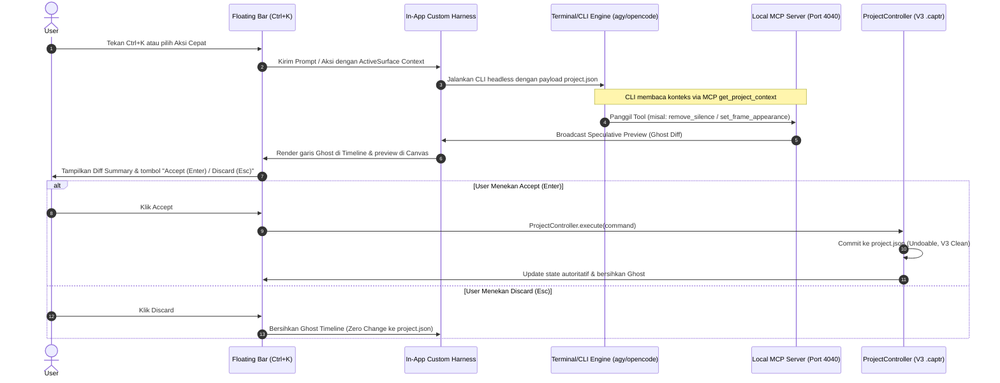

# Captr Studio AI Custom Harness & Context-Aware Video Editing Engine

**Status:** Draft / Proposed  
**Date:** 2026-10-18  

---

## 1. Problem & Core Principle

Integrasi AI pada perangkat lunak pengeditan video sering kali terjebak dalam dua masalah utama:
1. **Redundansi State & Engine**: AI membuat sistem paralel terpisah yang rumit, mencoba merender video sendiri atau menciptakan file sintetis perantara yang merusak integritas arsitektur project.
2. **Ketiadaan Kesadaran Konteks (Context Blindness)**: AI dan protokol eksternal (seperti MCP) tidak mengetahui apakah pengguna sedang membuka proyek atau berada di halaman Home, dan tidak tahu persis di bagian mana pengguna sedang mengedit (apakah sedang mengatur frame di Record Editor, menyeleksi klip di Story Editor, mengedit teks subtitle di Caption Editor, atau mengubah rasio di Artboard).

### Prinsip Inti Non-Redundan (The Lean Metadata Mutation Principle)
Di Captr Studio, file `.captr` (khususnya `project.json` sebagai indeks autoritatif) adalah *single source of truth* untuk seluruh state video (trek, klip, crop, transisi, keyframe, komposisi webcam/layar, appearance preset, dan caption).

Oleh karena itu, **tugas fundamental AI di Captr Studio adalah:**
> **Membaca metadata konfigurasi proyek dari file `.captr` (ditambah sidecar transkrip audio/telemetri kursor) -> Menghitung delta perubahan -> Mengubah metadata proyek di dalam file `.captr` secara atomik melalui `ProjectController.execute(...)`.**

AI **tidak** merender media sintetis, tidak membuat engine kompresi terpisah, dan tidak menduplikasi pipeline rendering. Ketika metadata `project.json` diperbarui secara atomik, preview canvas, timeline, dan engine export GPU secara otomatis mengevaluasi hasil video secara identik.

Terminal/CLI (`agy`, `opencode`, `hermes`, `cursor-cli`) hanya bertindak sebagai **execution pipe** di balik layar. Pengguna berinteraksi melalui **Custom Harness UI** native Captr Studio (Floating Context Bar `Ctrl+K`, tombol aksi kontekstual, Ghost Timeline preview, dan tombol Accept/Discard).

---

## 2. Goals & Non-Goals

### Goals
- **Active Surface & Navigation Awareness**: Server MCP dan Custom Harness mengetahui secara instan dan akurat apakah proyek sedang terbuka, halaman mana yang aktif, dan di permukaan editing mana pengguna berada (*Story Editor*, *Record Editor*, *Artboard*, *Caption Editor*, *Voiceover*, atau *Home*).
- **Hierarchical Model Settings**:
  - *Global App Preferences*: Konfigurasi default CLI runner (`agy`, `opencode`, `hermes`), default model, API keys/endpoints, dan executable path.
  - *Per-Project Settings*: Konfigurasi tersimpan di dalam `.captr` (`aiConfig`) untuk model override dan persona/instruksi proyek.
- **Fast Floating Command Interface (`Ctrl+K`)**: Bar melayang kontekstual yang langsung menyajikan tombol aksi cepat (*Contextual Action Pills*) relevan sesuai permukaan aktif pengguna saat itu.
- **Speculative Ghost Execution**: Perubahan yang diusulkan AI dipratinjau secara non-destruktif di canvas dan timeline (*Ghost Diff*) sebelum pengguna memutuskan untuk menerapkan (*Accept*) atau membatalkan (*Discard*).
- **Strict V3 Bundle Integrity**: Semua mutasi yang diterima dieksekusi melalui `ProjectController.execute` agar mendukung Undo/Redo (`Ctrl+Z`), menjaga integritas V3, dan tidak merusak auto-save.

### Non-Goals
- Tidak membuat server web eksternal berbasis cloud; runtime dan MCP berjalan lokal di mesin pengguna.
- Tidak mengekspos raw terminal shell sebagai UI utama bagi pengguna umum.
- Tidak menghasilkan file video dummy atau proxy sintetis; mutasi murni pada metadata `project.json`.

---

## 3. Active Surface & App Context Model

### Skema Konteks Terpadu (`CaptrAppContext`)
Disinkronkan secara real-time dari React state (`App.tsx`, `ProjectEditor.tsx`, `RecordingCompositionEditor.tsx`) ke Electron main process:

```typescript
export type AppActiveView = "home" | "editor" | "settings";

export type ActiveSurface =
  | { kind: "none" } // Saat di Home / Welcome / Tidak ada proyek aktif
  | {
      kind: "story-editor";
      selectedClipIds: string[];
      playheadUs: number;
      activeTrackId?: string;
      zoomScale: number;
    }
  | {
      kind: "record-editor";
      recordingAssetId: string;
      packageId: string;
      activeTab: "scene" | "appearance" | "cursor" | "layout";
      currentAppearancePreset?: string;
      outwardBorderWidth: number;
    }
  | {
      kind: "caption-editor";
      selectedSegmentIndex?: number;
      activeLanguage?: string;
      isBurnInEnabled: boolean;
      totalSegments: number;
    }
  | {
      kind: "artboard-canvas";
      artboardId: string;
      aspectRatio: "9:16" | "1:1" | "16:9" | "4:5";
      isRepurposing: boolean;
    }
  | {
      kind: "voiceover-studio";
      isRecording: boolean;
      takeCount: number;
    };

export interface CaptrAppContext {
  isProjectOpen: boolean;
  projectId?: string;
  projectTitle?: string;
  projectPath?: string | null;
  activeView: AppActiveView;
  activeSurface: ActiveSurface;
  availableAccelerators: Array<{
    id: string;
    label: string;
    description: string;
    toolName: string;
    shortcut?: string;
  }>;
  telemetrySummary?: {
    transcriptWordCount: number;
    hasCursorClicks: boolean;
    totalDurationUs: number;
  };
}
```

### Akselerator Kontekstual Berdasarkan Permukaan Aktif
Server MCP dan Command Bar `Ctrl+K` secara dinamis menyediakan toolset berikut:

| Permukaan Aktif (`activeSurface.kind`) | Tombol Aksi Relevan (Accelerators) | Target Mutasi di `.captr` |
|---|---|---|
| **`none` (Home Screen)** | `[ Create Project from Recording ]`, `[ Batch Transcribe Audio ]`, `[ List Recent Projects ]` | Project lifecycle & filesystem |
| **`story-editor`** | `[ Remove Silence ]`, `[ Split at Current Word ]`, `[ Ripple Delete Gaps ]`, `[ Add B-Roll Card ]` | `project.tracks[].clips`, `startUs`, `sourceInUs`, `sourceOutUs` |
| **`record-editor`** | `[ Auto-Zoom to Clicks ]`, `[ Style: Brutalism ]`, `[ Style: Glassmorphism ]`, `[ Outward Border +4px ]` | `project.compositions[]` (window & webcam settings) |
| **`caption-editor`** | `[ Fix Typos with AI ]`, `[ Split into Short Lines ]`, `[ Sync Word Timestamps ]`, `[ Yellow Pop Style ]` | `project.tracks[].clips[].content.captions` |
| **`artboard-canvas`** | `[ Repurpose 9:16 Shorts ]`, `[ Auto-Center Webcam & Screen ]`, `[ Square 1:1 Layout ]` | `project.repurposeBoard.artboards[]` |

---

## 4. Model Settings & Configuration Hierarchy

Pengaturan AI diatur secara berjenjang (*layered hierarchy*):

### 1. Global Preferences (`AppSettingsDialog` -> Tab "AI Harness")
Disimpan di local storage / electron store global aplikasi:
```typescript
export interface GlobalAiSettings {
  preferredRunner: "agy" | "opencode" | "hermes" | "cursor" | "custom";
  customRunnerPath?: string;
  defaultModel: string; // e.g. "gemini-1.5-pro", "claude-3-5-sonnet", "qwen2.5-coder"
  apiBaseUrl?: string;
  apiKey?: string;
  mcpServerPort: number; // default: 4040
  enableAutoMcpServer: boolean;
  enableGhostPreview: boolean;
}
```

### 2. Project-Level Settings (`TimelineProject.aiConfig` di `.captr`)
Tersimpan di `project.json` di dalam bundle `.captr`:
```typescript
export interface ProjectAiConfig {
  modelOverride?: string;
  personaPrompt?: string; // e.g. "Fast-paced YouTube Shorts editor with 2-word dynamic captions"
  silenceThresholdMs?: number; // default 600ms
  defaultCaptionStyle?: string;
}
```

Jika proyek tidak memiliki `aiConfig`, pengaturan otomatis mewarisi (*fallback*) ke `GlobalAiSettings`.

---

## 5. Execution Pipeline & Custom Harness UI Flow

### Diagram Alur Eksekusi Non-Redundan



---

## 6. Verifikasi & Pengujian

1. **Unit Test Konteks & Surface Awareness**:
   - Uji `useActiveSurfaceTracker`: memastikan transisi antar Home -> Story Editor -> Record Editor -> Caption Editor mengirim event IPC yang tepat.
   - Uji Server MCP `get_project_context`:
     - Saat proyek ditutup: mengembalikan `{ isProjectOpen: false, activeView: "home" }` tanpa error.
     - Saat proyek dibuka di Record Editor: mengembalikan detail komposisi dan akselerator `record-editor`.
2. **Unit Test Mutasi Metadata `.captr`**:
   - Memastikan eksekusi aksi AI murni memanggil `ProjectController.execute(...)` tanpa memodifikasi file media asli di `assets/<assetId>/`.
   - Menguji alur `Undo` (`Ctrl+Z`) dan `Redo` (`Ctrl+Y`) setelah aksi AI dieksekusi.
3. **Regression Check & V3 Compatibility**:
   - Memastikan tidak ada penulisan folder legacy `slides/` atau `slide.json`.
   - Memastikan file `.captr` tetap backward-compatible dengan versi `1.4.0-beta.3`.
